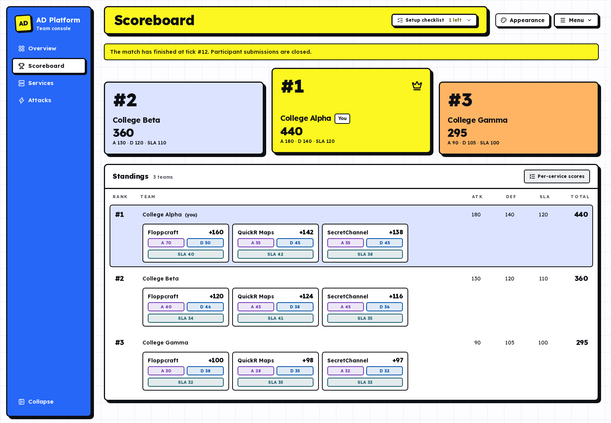
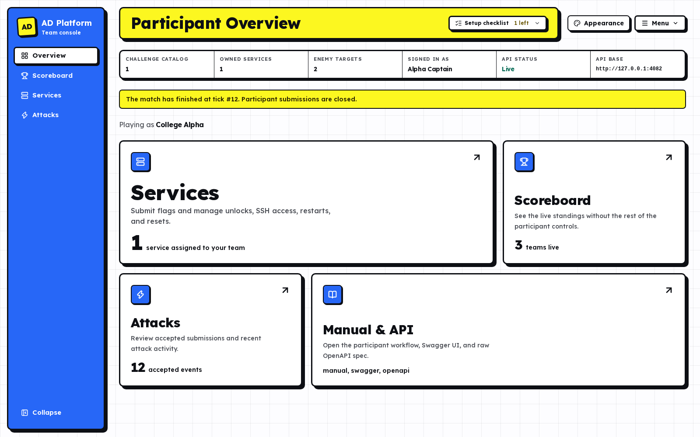
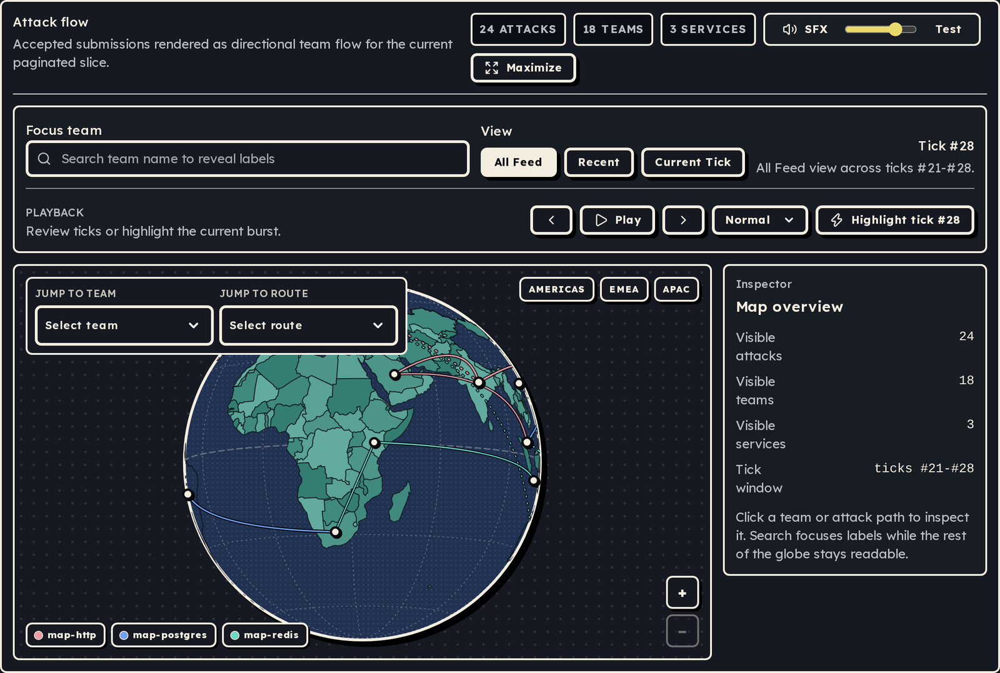
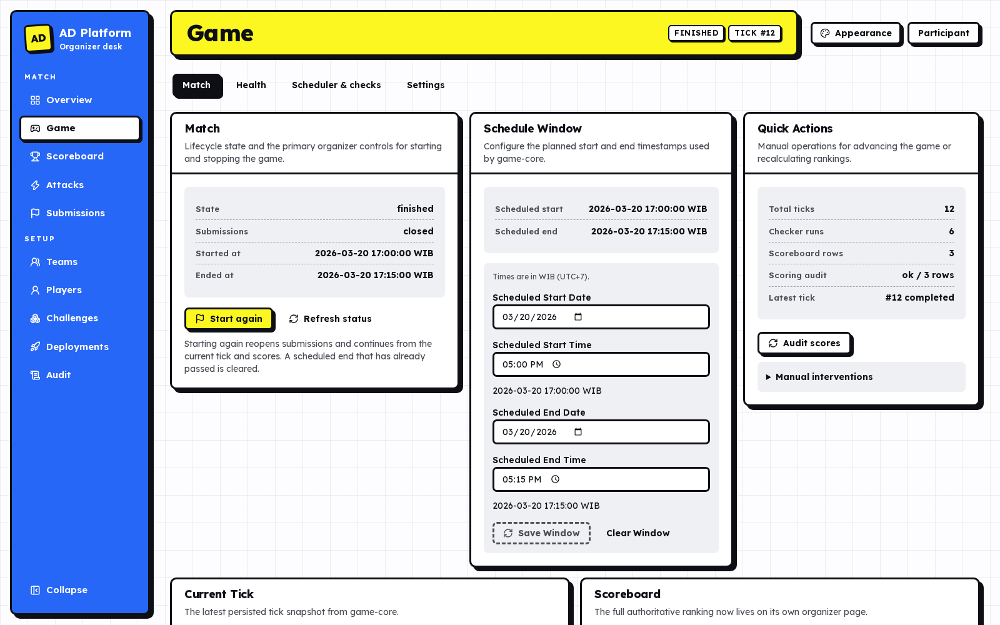
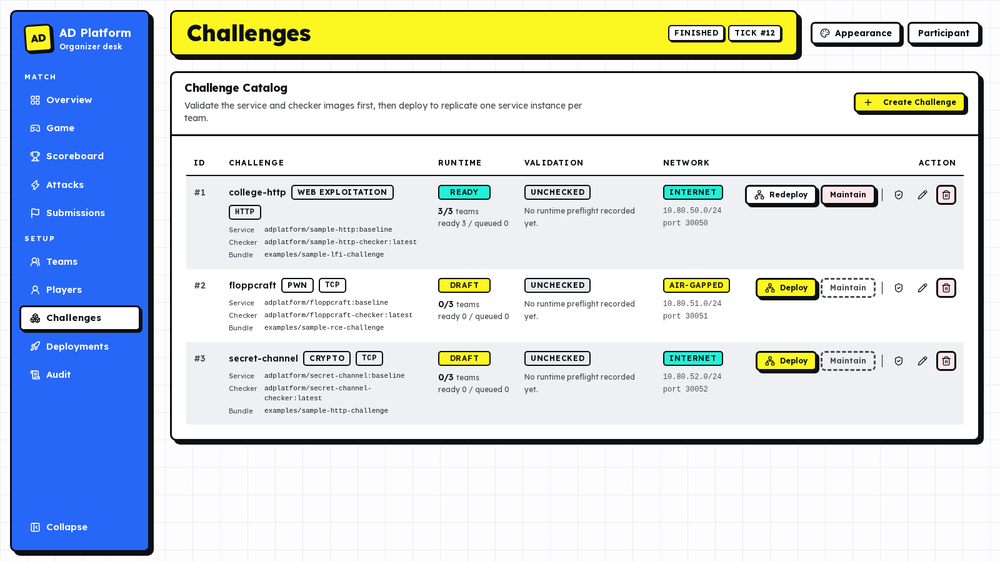
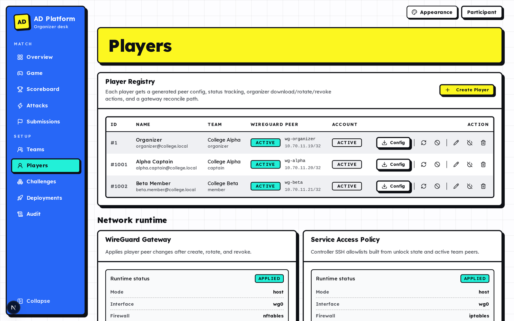
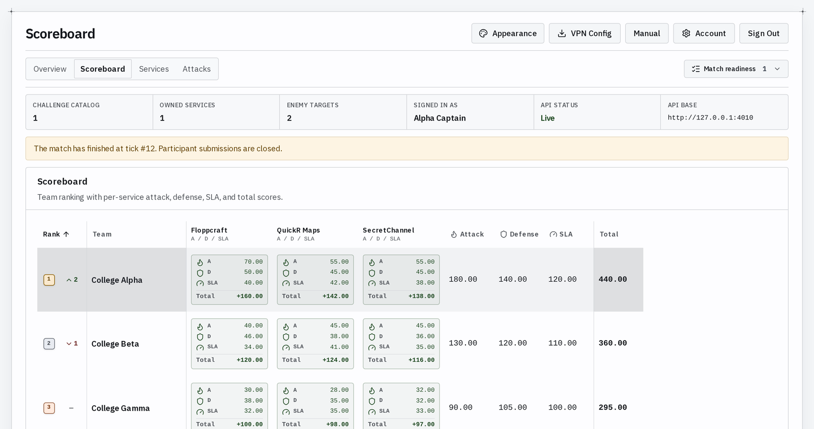
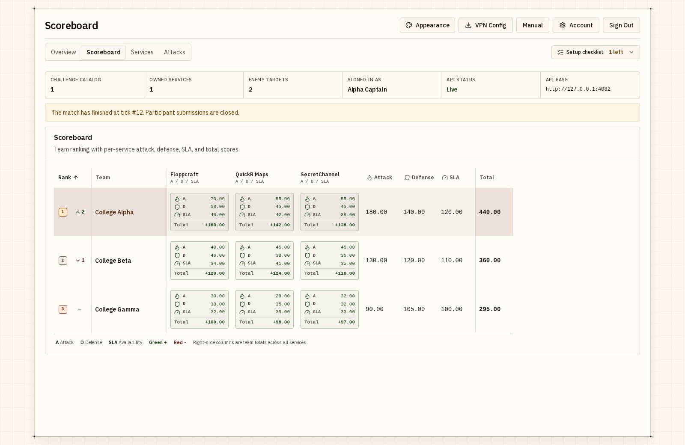
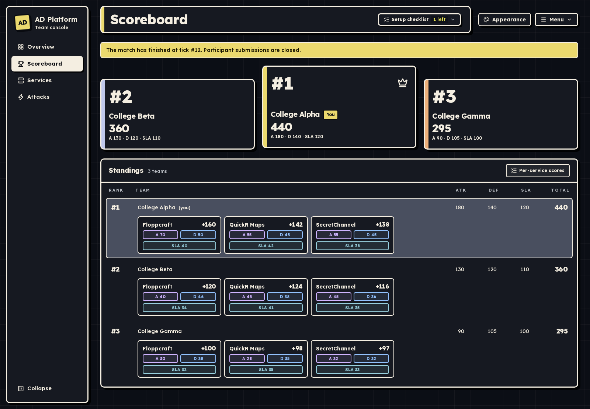

# ADTickPlatform

A self-hosted platform for running Attack-Defense CTF events: tick scheduling, per-team service runtimes, flag validation, scoring, WireGuard access, and a live web console for players and organizers.

[](https://go.dev)
[](https://www.typescriptlang.org)
[](https://nextjs.org)
[](https://docs.docker.com/compose/)
[](LICENSE)

<p align="center">
  
</p>

---

## Contents

- [What it does](#what-it-does)
- [Screenshots](#screenshots)
- [Architecture](#architecture)
- [Quick start](#quick-start-local-development)
- [Production deployment](#production-deployment)
- [Testing](#testing--validation)
- [Writing challenges](#writing-challenges)
- [Documentation](#documentation)

---

## What it does

ADTickPlatform runs the whole game loop of an Attack-Defense CTF. Every tick it plants flags, runs checkers, scores attacks and uptime, and pushes the results to every connected browser.

- **Match control.** Start, stop, freeze and pause the match. Pausing blocks submissions, stops the scheduler, holds the tick counter and limits WireGuard access to organizer peers. A scheduled start/end window lets the match run unattended.
- **Per-team service runtimes.** Each challenge is replicated once per team in its own Docker runtime on a dedicated subnet. Organizers validate images, deploy, redeploy and put services under maintenance from the console.
- **Scoring.** FaustCTF-style attack points that decay as more teams exploit the same service, plus defense and SLA uptime scoring. Scores come from a replayable pipeline, so they can be audited and recalculated.
- **Live views.** The scoreboard, the attack feed and a 3D attack globe update over Server-Sent Events. A scoreboard freeze hides standings while the attack feed stays live.
- **Network access.** One WireGuard peer per player, with config download, key rotation and revoke. `nftables` host rules keep team runtimes isolated from each other.
- **Exploit-gated SSH.** Teams unlock SSH to their own service containers by proving an exploit, then patch and harden them in place.
- **Organizer themes.** Organizers pick the platform theme (Graphite, Paper or Neubrutalism); each player chooses light, dark or system mode.

---

## Screenshots

The participant console and organizer desk below are shown with demo data.

### Participant console

<p align="center">
  
  
</p>

### Organizer desk

<p align="center">
  
</p>

<p align="center">
  
  
</p>

### Themes

The organizer sets the theme for the whole platform. Players can choose Light, Dark, or System.

<p align="center">
  
  
  
</p>
<p align="center"><sub>Graphite · Paper · Neubrutalism (dark)</sub></p>

---

## Architecture

Go microservices behind a Caddy reverse proxy, with PostgreSQL as the source of truth and Redis for queues, fast paths and realtime fan-out.

| Service | Role |
|---|---|
| `api-gateway` | Single entry point for the web app: auth, routing, rate limits, audit log |
| `game-core` | Owns the tick clock, match lifecycle, schedule and flag validity windows |
| `submission-service` | Validates submitted flags, rejects duplicates and expired flags, emits attack events |
| `checker-runner` | Runs `put` / `get` / `check` per service per tick and reports SLA results |
| `scoring-worker` | Computes attack, defense and SLA scores and publishes scoreboard snapshots |
| `controller-service` | Provisions and resets team runtimes and issues SSH access after unlock |
| `realtime-gateway` | Streams scoreboard, attack and service-health updates to browsers |
| `wireguard-gateway` | Manages player peers and applies gateway changes |
| `capture-bootstrap` | Startup gate that verifies the host capture policy before the app takes over |

The frontend is a Next.js 16 / React 19 app in `apps/web`. See [System Architecture](docs/architecture.md) for the full design.

```text
.
├── apps/web          # Next.js participant console and organizer desk
├── deploy/           # Compose files, Dockerfiles, Caddy config, host security
├── docs/             # Architecture, rules, runbooks and API specs
├── examples/         # Sample challenges (HTTP, LFI, RCE)
├── internal/         # Shared Go packages
├── make/             # Makefile fragments
├── scripts/          # Setup, seeding and smoke-test scripts
└── services/         # Go backend services
```

---

## Quick start (local development)

### Prerequisites

- [Docker](https://docs.docker.com/get-docker/) with Docker Compose
- [Go](https://go.dev/doc/install) 1.27+
- [Bun](https://bun.sh/) 1.4+
- `make`

### Setup

1. Copy the local environment file:
   ```bash
   cp .env.example .env
   ```

2. Start PostgreSQL and Redis (Prometheus and Grafana come up too):
   ```bash
   docker compose -f deploy/compose/dev.yml up -d
   ```

3. Run the backend services against PostgreSQL:
   ```bash
   make run-backend-stack-postgres
   ```
   Or use `make run-backend-stack` to run them with in-memory storage and skip the database.

4. Install dependencies and start the web app:
   ```bash
   cd apps/web
   bun install
   bun run dev
   ```

---

## Production deployment

Production runs behind Caddy with automatic database migrations and host network enforcement.

1. Generate secrets and set the public address:
   ```bash
   make generate-prod-env CHALLENGE_SOURCE_HOST_PATH=/srv/adplatform/challenge-sources
   make setup-prod-env DOMAIN=ctf.example.com SCHEME=https CAPTURE_MODE=guarded
   ```
   This writes `deploy/compose/prod.env` with random secrets and an `ADMIN_PASSWORD`. A public domain gets a certificate from Caddy's ACME; `localhost` or a bare IP gets a generated self-signed certificate.

2. Check the host, start the stack, and create the organizer account:
   ```bash
   make preflight-prod-host
   make up-prod-host
   make create-admin   # uses the ADMIN_* values from prod.env
   ```
   Host inspection commands need root or `sudo` with `NOPASSWD`.

> **Packet capture:** guarded live capture needs BPF LSM, kernel BTF, cgroup v2 and local rootful Docker. Setup enables it unless you choose a mode, and preflight rejects hosts that can't support it. Read [capture deployment and migration](deploy/security/direct-capture/README.md) before upgrading existing challenges. Use `CAPTURE_MODE=disabled` for offline PCAP analysis only.

Full guide: [Deployment: Host (Debian/Ubuntu/Arch)](docs/deployment-host.md).

---

## Testing & validation

| What | Command |
|---|---|
| Full CI run | `make ci` |
| Go unit tests | `make test` |
| Web typecheck | `bun run web:typecheck` |
| Web unit tests | `bun run web:test` |
| End-to-end and visual regression | `bunx playwright install chromium && make e2e` |
| Sample challenge smoke test | `make smoke-sample-challenge-docker` |
| Attack map load simulation | `make simulate-attack-map-load` |
| Database restore drill | `make smoke-prod-db-restore` |

Reset the database and runtime files to a clean match:

```bash
make bootstrap-clean-match
```

---

## Writing challenges

Challenges must follow the [Challenge Runtime Contract](docs/challenge-runtime.md). In short, the service image needs:

- a working `/bin/sh`;
- an SSH daemon (`sshd` or `dropbear`);
- a password command (`chpasswd` or `passwd`);
- a way to expose or protect the generated `AD_PLATFORM_UNLOCK_PROOF` environment variable.

Start from one of the examples:

- [Sample HTTP challenge](examples/sample-http-challenge/README.md)
- [Sample LFI challenge](examples/sample-lfi-challenge/README.md)
- [Sample RCE challenge](examples/sample-rce-challenge/README.md)

---

## Documentation

| Guide | For |
|---|---|
| [System Architecture](docs/architecture.md) | How the services fit together |
| [Game Rules & Runtime Flows](docs/game-rules.md) · [Scoring](docs/scoring.md) | Tick structure and scoring formulas |
| [Participant Platform Manual](docs/platform-manual.md) | Players |
| [Deployment: Host](docs/deployment-host.md) | Setting up a production host |
| [Organizer Admin API](docs/admin-api.md) · [Organizer Submissions](docs/organizer-submissions.md) | Running the match programmatically |
| [Operator Cheatsheet](docs/operator-cheatsheet.md) | Common control commands |
| [Ops Runbook](docs/ops-runbook.md) · [Trusted Reconcile](docs/trusted-reconcile-runbook.md) | Handling incidents during an event |
| [Final Rehearsal Checklist](docs/final-rehearsal-checklist.md) | Pre-event checks |
| [Challenge Runtime Contract](docs/challenge-runtime.md) | Challenge authors |
| [Platform API (OpenAPI)](docs/platform-api-v2.openapi.yaml) | Client and tool builders |

A running platform also serves its docs at `/docs/participant`, `/docs/platform-api` and `/docs/platform-api-v2.openapi.yaml`.

---

## License

[MIT](LICENSE)
